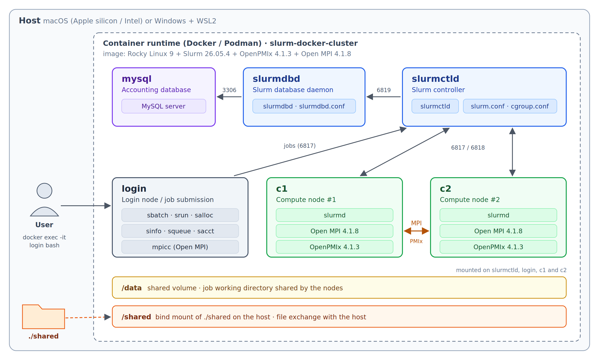

# Installation of Slurm Cluster Containers

This document describes how to set up a local, container-based Slurm development environment. The environment is intended for developing and testing QRMI and the SPANK plugin without access to a production HPC cluster.

## Jump To

- [Container Contents](#container-contents)
- [Prerequisites](#prerequisites)
- [Creating a Docker-based Slurm Cluster](#creating-a-docker-based-slurm-cluster)
  - [1. Building the containers](#1-building-the-containers)
  - [2. Starting the cluster](#2-starting-the-cluster)
  - [3. Verifying the cluster](#3-verifying-the-cluster)
  - [4. Stopping and cleaning up](#4-stopping-and-cleaning-up)

## Container Contents

All cluster nodes are built from the same base image with the following software stack:

| Component | Version | Notes |
|-----------|---------|-------|
| Base OS   | Rocky Linux 9 | RHEL 9–compatible base image |
| Slurm     | master（26.11) | Workload manager (`slurmctld`, `slurmd`, `slurmdbd`) |
| OpenPMIx  | 4.1.3   | Process management interface used by Slurm and Open MPI |
| Open MPI  | 4.1.8   | MPI implementation, built against the bundled OpenPMIx |

Slurm and Open MPI share the same OpenPMIx installation, so MPI programs can be launched directly with `srun --mpi=pmix` without using `mpirun`.

## Prerequisites

A container manager such as one of the following:

- [Docker](https://docs.docker.com/get-docker/)
- [Podman](https://podman.io/getting-started/installation.html)
- [Rancher Desktop](https://rancherdesktop.io/)

> **Note for Podman users:** `docker-compose` must be installed separately. On macOS, install it with:
>
> ```bash
> brew install docker-compose
> ```
>
> On Ubuntu (including WSL2), install `podman-compose` instead: `sudo apt install podman podman-compose`. Ubuntu's `docker-compose` package is the old v1 and also installs the Docker engine (`docker.io`) as a recommended package.
>
> The build compiles Slurm and Open MPI from source, so give the Podman machine at least 4 GB of memory:
>
> ```bash
> podman machine stop
> podman machine set --cpus 4 --memory 4096
> podman machine start
> ```

> **Note for Windows (WSL2) users:**
>
> - **Location**: clone and edit the files inside the WSL file system (for example `~/sc26-tut171-prep`), not under `/mnt/c`, to avoid permission and performance problems.
> - **Container manager**: Docker Engine installed inside the WSL distribution works (tested with Docker 28.1.1 on Ubuntu 20.04); Docker Desktop also works. If systemd is not enabled in the distribution, start the daemon after each WSL restart with `sudo service docker start`.
> - **Resources**: tested on a 2-CPU host with 2.8 GB of memory available to WSL; the first build took about 25 minutes. Memory is set with `memory=` in `.wslconfig`.
> - **CPU count**: `slurm.conf` defines 4 CPUs per node. `SlurmdParameters=config_overrides` lets nodes register with that count even if the host has fewer cores, so the nodes do not end up in the `inval` state.

## Creating a Docker-based Slurm Cluster

> **Note for Podman users:** The commands below use the `docker` CLI. With Podman, replace `docker` with `podman` (for example `podman logs pbs-server`, `podman exec ...`), or define `alias docker=podman`. `docker compose` / `docker-compose` work with Podman as long as `docker-compose` is installed.


### 1. Building the containers

Run the following command from the directory containing `compose.yml`:

```bash
docker compose build --no-cache
```

The first build compiles Slurm, OpenPMIx and Open MPI from source, so it may take some time.

### 2. Starting the cluster

```bash
docker compose up -d
```

Use `docker ps` to check that the following six containers are running:

| Container   | Role |
|-------------|------|
| `mysql`     | Database node (Slurm accounting storage) |
| `slurmdbd`  | Slurm database daemon node |
| `slurmctld` | Central management node (Slurm controller) |
| `login`     | Login node (job submission) |
| `c1`        | Compute node #1 |
| `c2`        | Compute node #2 |

The containers share one directory:

| Path | Backing storage | Purpose |
|------|-----------------|---------|
| `/shared` | `./shared` on the host (bind mount) | Exchanging files with the host |

Job output files are written back directly to this path (`$usecp`), so jobs can be submitted from `/shared`.

You now have a Slurm cluster as shown below:

<p align="center">
  
</p>

### 3. Verifying the cluster

Open a shell on the login node:

```bash
docker exec -it login bash
```

Check that both compute nodes are available (they should be in the `idle` state):

```bash
sinfo -N -l
scontrol ping
sacctmgr show cluster
```

```
Fri Oct 09 11:07:50 2026
NODELIST   NODES PARTITION       STATE CPUS    S:C:T MEMORY TMP_DISK WEIGHT AVAIL_FE REASON              
c1             1   normal*        idle 4       4:1:1   1000        0      1   (null) none                
c2             1   normal*        idle 4       4:1:1   1000        0      1   (null) none

Slurmctld(primary) at slurmctld is UP

   Cluster     ControlHost  ControlPort   RPC     Share GrpJobs       GrpTRES GrpSubmit MaxJobs       MaxTRES MaxSubmit     MaxWall                  QOS   Def QOS 
---------- --------------- ------------ ----- --------- ------- ------------- --------- ------- ------------- --------- ----------- -------------------- --------- 
     linux       10.89.0.4         6817 11520   
```

Run a simple job across both nodes:

```bash
srun -N 2 hostname
```

```
c2
c1
```

Confirm that the PMIx plugin is available to Slurm:

```bash
srun --mpi=list
```

```
srun --mpi=list
MPI plugin types are...
	none
	cray_shasta
	pmi2
	pmix
specific pmix plugin versions available: pmix_v4
```

To test MPI, first copy the example programs from the host into the shared directory:

```bash
# On the host
cp examples/* shared/
```

```bash
cd /shared
mpicc -o hello_mpi hello_mpi.c
sbatch hello_mpi.sbatch
cat hello_mpi.o*
```

```
=== Allocated nodes ===
c1
c2
=== srun (launched via Slurm + PMIx; no -np or hostfile needed) ===
Hello from rank 1 of 4 on c1
Hello from rank 0 of 4 on c1
Sum of ranks = 6 (expected 6)
Hello from rank 2 of 4 on c2
Hello from rank 3 of 4 on c2
```

Confirm the python3.12 is available on container

```
python3.12 -c 'import sys; print(sys.version)'
```

```
3.12.15 (main, Oct  1 2026, 00:00:00) [GCC 11.5.0 20240719 (Red Hat 11.5.0-14)]
```

To test MPI with mpi4py, first create a Python virtual environment in the shared directory, then submit the job:

```
python3.12 -m venv /shared/pyenv
source /shared/pyenv/bin/activate
pip install mpi4py
cd /shared
sbatch hello_mpi4py.sbatch
cat hello_mpi4py.o*
```

```
[mpi4py] rank 2 of 4 on c2 (Python 3.12.15)
[mpi4py] rank 0 of 4 on c1 (Python 3.12.15)
[mpi4py] rank 3 of 4 on c2 (Python 3.12.15)
[mpi4py] rank 1 of 4 on c1 (Python 3.12.15)
[mpi4py] sum of ranks = 6 (expected 6)
```


### 4. Stopping and cleaning up

Stop the cluster while keeping its data (job accounting database, etc.):

```bash
docker compose down
```

Stop the cluster and remove all volumes for a completely fresh start:

```bash
docker compose down -v
```

## END OF DOCUMENT
